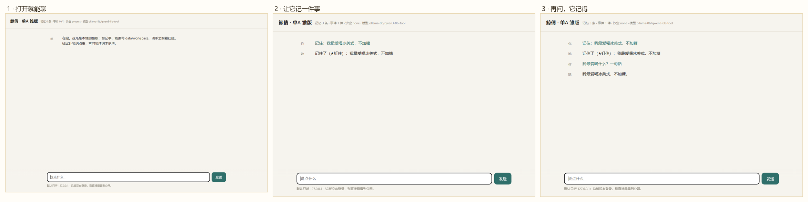
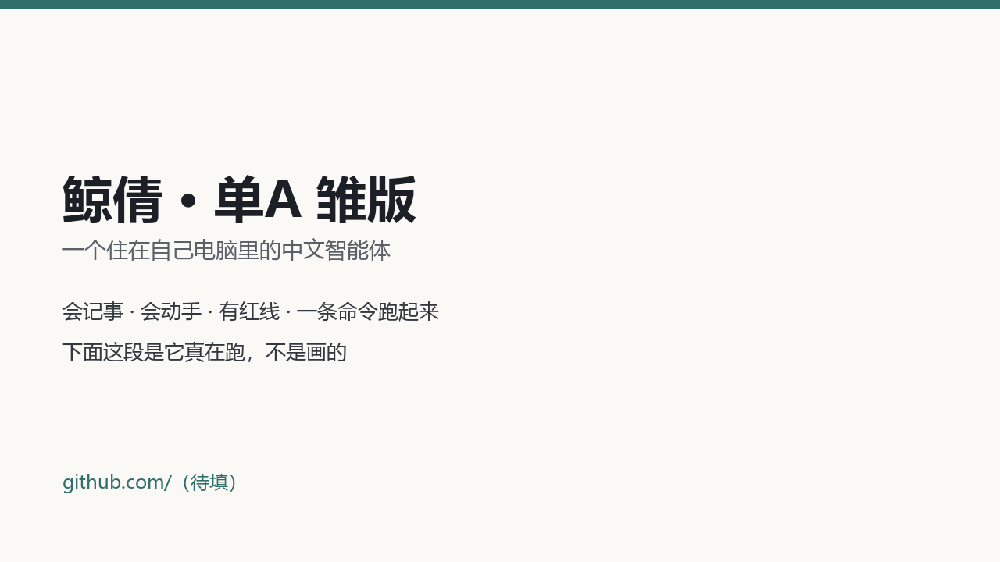

# 鲸倩 Jīngqiàn · 单A 开源雏版

[](https://github.com/jingqian-sy/jingqian-single-a/actions/workflows/ci.yml)
[](LICENSE)
[](package.json)

> 一个住在你自己电脑里的中文智能体：会记事、会算账、会动手，但手上有一条红线。

## 两个形态：软件版（主）和插件版（次）

**① 软件版：独立窗口，双击就开**（给普通用户用的形态）

```powershell
# 编（系统自带 .NET Framework，不引 NuGet、不用 WebView2）
desktop\build-desktop.cmd

# 装：拷程序 + 建桌面/开始菜单快捷方式（图标用 desktop\icon.ico）
powershell -ExecutionPolicy Bypass -File 安装.ps1
```

装完桌面「鲸倩」双击就开，不跳浏览器。窗口里能聊天、看工具调用、搜/删记忆、改设置
（模型/密钥/沙盒档位/命令白名单/记忆开关/可选 QQ 桥接），底部一条数据栏显示
tok/s、缓存、上下文、今日调用、走哪家、时钟。**文件和图片可以直接拖进窗口**：
文本接进对话、图片走多模态（模型不支持看时会直说）。详见 [docs/软件版.md](docs/软件版.md)。


<sub>上面是真窗口录的：记一件事 → 问回来 → 让它排个先后（GIF 7 帧，约 7 秒）。
静态截图见 docs/assets/软件版-对话.png。标题栏在最上、功能按钮第二排、气泡上方是名字和时间、
工具调用显示成居中的灰色小条、输入框有提示字、底部数据栏。
跑 `desktop\鲸倩.exe --verify` 可以自己复现这四项自检（不弹窗）。
录演示时用 `desktop\鲸倩.exe --send "一句话"`，会走同一套发送逻辑，不用模拟键盘。
打开时会先拉 `/api/history?session=web` 把历史铺成气泡，有历史就不显示欢迎语。</sub>

**② 插件版：一行配置挂到 MCP 客户端**（DSH / Cherry Studio 这类）

给已经在用别的 AI 客户端、不想再开一个窗口的人：把「这台机器上的鲸倩」挂进去，
那个客户端就多出 4 个工具，聊天、记忆、工具、红线全走本机服务（不是另起一套）。

```json
{
  "mcpServers": {
    "jingqian": {
      "command": "node",
      "args": ["D:\\鲸倩开源-雏版\\src\\mcp\\server.js"]
    }
  }
}
```

- `command` 要能找到 `node`；找不到就写 node 的绝对路径（比如 `C:\\Users\\你\\AppData\\Local\\Jingqian\\runtime\\node-v22.14.0-win-x64\\node.exe`）。
- 服务地址默认 `http://127.0.0.1:7889`，换端口用环境变量 `JINGQIAN_URL`。
- 服务没起时插件版会自己拉一次 `node src/server.js`，和软件版同一套逻辑。

挂上后多出的 4 个工具：

| 工具 | 干什么 | 背后接口 |
| --- | --- | --- |
| `ask` | 跟鲸倩说一句话，返回她的原话（带人格、记忆、工具、红线） | `POST /api/chat` |
| `memory_search` | 搜这台机器的记忆库 | `GET /api/memory?query=` |
| `memory_remember` | 写一条记忆（可 pinned） | `POST /api/memory` |
| `stats` | 模型 / 今日调用 / tokens / 记忆条数 | `GET /api/stats` |

和软件版共用同一台本机服务、同一份记忆——插件里记的事，软件版打开就能看到。
只适合本机客户端，**没有鉴权，别把 7889 暴露到公网**。细节见 [docs/插件版.md](docs/插件版.md)；
自测跑 `node evals/mcp-test.js`（真按 MCP stdio 协议聊一遍，14 条断言，不联网）。

**③ 网页版：开发调试用，不是给用户的功能形态**

`node src/server.js` 后开 `http://127.0.0.1:7889`。三个入口（桌面 / 插件 / 网页）都是一套服务，
网页版别写进用户教程，也别拿它当发布形态。

**接 QQ（可选，默认关）**：入方向 `/api/qq/incoming`、出方向 `/api/qq/send`，白名单 + 群里 @ 才回，
默认 `enabled:false`。怎么配、有什么风险见 [docs/接QQ.md](docs/接QQ.md)。

## 30 秒看懂

**这是什么**：一个本地优先的中文智能体，Node 写的，零依赖，服务一跑就通。
它能记住你（不是把聊天记录塞回上下文），能读写文件、跑白名单命令，动手前会过四级红线，
每次调模型都记账。

**它跟「输入框套 API」有什么不一样**：

- **真记得**：记忆会老、会淡、会被整理成「一件事」，钉住的约定永不遗忘。
- **真省钱**：粗活交给本地 8B，值钱的判断才上云端；同一批 55 题 × 2 遍，
  本地实测 **0 元**，同 tokens 全走云端约 **0.78 元**（[算法与来源](docs/省钱对比.md)）。
- **真能验**：55 题评测全部机器判定（看盘、看审计、看事件层），每题跑两遍，
  [成绩和失败项](data/report.md)都摆着，不是「模型说自己过了」。

**三步看清它记得住**（同一台机器真跑的三帧，不是示意图）：



<sub>① 打开就是聊天框；② 说「记住：我最爱喝冰美式」，它钉住；③ 再问「我最爱喝什么」，它答得出来。</sub>

<details>
<summary>不想看长文？这里是最短路径</summary>

```bash
desktop\build-desktop.cmd                   # 编软件版（需要系统自带 .NET Framework）
powershell -ExecutionPolicy Bypass -File 安装.ps1   # 装软件版 + 快捷方式
node src/mcp/server.js                      # 插件版（MCP，stdin/stdout）
node evals/ci.js                            # 不需要密钥的全套检查（11 秒）
```

模型二选一：本机 `ollama pull qwen3:8b`，或在 `config.json` 里填一家云端 key。
</details>

---

市面上多数「AI 助手」是一个输入框套在 API 外面。鲸倩想解决的是另外几个问题：

- **它记得你**：不是把聊天记录塞回上下文，而是有一份会老、会淡、会被整理成「事」的长期记忆。
- **它替你省钱**：能干的粗活交给本地 8B，值钱的判断才上云端；每次调用都记账，一家挂了自动换下一家。
- **它真的动手**：读写文件、跑命令、记事提醒，但手上有四级红线，动过的事都留审计。
- **它属于你**：整个文件夹拷走就能在另一台电脑跑起来，记忆和人格跟着走。

这是**单A 模板**（一个主脑、单任务串行）。同一份协议下还会有一个 3A 模板（调度 → 执行 → 质检）
用来对比——两个模板跑同一批任务，各自一套实现、一套库、一套账本，不互相 import。

参与方式见 [CONTRIBUTING.md](CONTRIBUTING.md)，安全问题见 [SECURITY.md](SECURITY.md)。

---

## 它有什么（不是功能列表，是几处真下了功夫的地方）

### 一、混合记忆：关键词 + 向量 + 事件层

- **两路并行召回**：关键词（BM25 味道）对专名/编号准，向量对「意思相近但没共词」有用，
  两路合并打分，谁也没把谁替掉（没配 embedding 就自动降级成纯关键词，不报错）。
- **遗忘曲线 + 重要性分层**：日常流水半衰期 14 天自己淡掉，约定、生日、雷点可以钉住（pinned）永不衰减。
- **事件层与时间轴**：零散的一句话会被串成「一件事」——同一实体、7 天窗口内的记忆归成一件事，
  带起因、经过、结果、时间点；检索时先看事件再看句子，不按句子平铺。
- **主动整理**：闲下来（默认 60 分钟一次）自己复盘，合并重复、把老事件压成摘要，别让库无限膨胀。

细节见 [`docs/记忆设计.md`](docs/记忆设计.md)。

### 二、模型的账本与路由

- 所有提供方都走 OpenAI 兼容的 `/chat/completions`：云端 DeepSeek / 智谱、本地 Ollama 都是同一个适配层。
- 选路三档：`cheap-first`（默认，先免费/本地）、`cloud-first`、`fixed`；
  再加一层难度判断——话长或带「分析/架构/为什么/代码」这类词，先上云端。
- 按天按提供方记账（tokens / 调用次数 / 估算花费），失败自动换下一家，切换写 `data/route.log`。

### 三、会动手，但有底线

- 工具：读文件、写文件、列目录、跑命令（白名单）、记事、查记忆、事件时间轴、提醒。
- 四级红线：**P0 直接拒 / P1-P2 等你一句话确认 / P3 放行**，每一次判定都进 `data/audit.log`。
- 路径锁在 `data/workspace` 里，越界要确认；命令只走白名单。
- 沙盒是**可选项，默认关**（见下）。

---

## 架构

```
                 ┌─────────────────────────────┐
   你说话  ─────▶│  主脑（人格 + 判断 + 汇报）   │
                 └──────────┬──────────────────┘
                            │ 单线程工具循环（≤12 步，有预算护栏）
        ┌───────────────────┼────────────────────┐
        ▼                   ▼                    ▼
  ┌───────────┐      ┌────────────┐      ┌───────────────┐
  │ 记忆系统   │      │ 模型路由    │      │ 工具 + 红线    │
  │ 关键词召回 │      │ 云端多家    │      │ 文件/命令/提醒 │
  │ 向量召回   │      │ 本地 8B     │      │ 审计日志       │
  │ 事件/时间轴│      │ 额度账本    │      │ 沙盒（可选）   │
  └───────────┘      └────────────┘      └───────────────┘
```

> 一句话：主脑只管判断和说话，粗活和记忆都外包给专门的模块，出事了每一层都有日志。

---

## 安装（推荐）

下载后双击 `安装.cmd`：装到 `%LOCALAPPDATA%\Jingqian`，桌面生成「鲸倩」，开始菜单里有「中控台」。
**没装 Node 也不怕**：安装器会自己下一份便携版（约 30MB，只下一次），不污染系统。

装好后：
1. 打开开始菜单 → 鲸倩 → 中控台，填一家模型的地址、模型名、密钥（页面上只显示前后各四位）。
2. 双击桌面的「鲸倩」就能聊。

## 快速开始（不想安装，直接跑）

要求：**Node.js 22 或以上**（这版零依赖，不用 `npm install`）。

```bash
# Windows
run.cmd

# macOS / Linux
chmod +x run.sh && ./run.sh
```

第一次跑会从 `config.example.json` 复制一份 `config.json`，然后浏览器打开 `http://127.0.0.1:7889`。

接模型，二选一（**配置里已经内置好三家云端，只差 key，不用自己找 base/model**）：

1. **云端（便宜、快）**：`config.example.json` 里已经写好 智谱 GLM-4-Flash（有免费额度）、
   DeepSeek、硅基流动 三家，`key` 都是空的。注册拿到 key 粘进去就能用；软件版设置页里有
   「申请密钥」按钮，直接把你送到申请页。也可以不写进文件，用环境变量
   `ZHIPU_API_KEY` / `DEEPSEEK_API_KEY` / `SILICONFLOW_API_KEY`——配置里 `"env"` 字段就是干这个的。
2. **本地（不要钱、慢一点）**：装好 Ollama 后 `ollama pull qwen3:8b`，配置里已经有一条
   `ollama-8b`，`run.cmd` 起来就能直接用。

软件版的做法更贴近小白：第一次打开如果一家都没接上，会直接弹一句「先填一家模型」，
带推荐顺序（智谱免费 → DeepSeek 便宜 → Ollama 不花钱）；进设置后列表里每一家都标着
「已填 / 未填」，选中点「申请密钥」就去拿。

想省事，一条命令：


**真跑一遍给你们看**（这段是用项目自带的浏览器自动化自己操作录的，不是摆拍）：



记事 → 关掉重开 → 问回来 → 真调工具写文件 → 打开设置。GIF 8 帧，约 24 秒。

```bash
node src/server.js
```

自检不用开口聊天：`node evals/selfcheck.js`（或者开页面看顶部那行小字）。

### 先看它演一遍（30 秒，不用 key）

```bash
demo.cmd      # Windows
./demo.sh     # macOS / Linux
```

三步：让她记一件事 → 问回来 → 跑一条白名单命令，每步都把「发生了什么」打在终端上。
本地 Ollama 优先；一个可用模型都没有时，会明确告诉你缺什么（pull 哪个模型 / 填哪家 key），
不会假装跑成功。演示数据写在 `.demo/`，可以直接删。

### 跑测试（不需要密钥、不联网）

```bash
node evals/ci.js     # 语法 + 判定器单测 + 工具/红线单测 + 冒烟 + 6 题评测子集
npm test             # 只跑两组单元测试
```

CI 用的是一台本地假模型（`evals/mock-provider.js`），不需要任何 key；
仓库里的 [.github/workflows/ci.yml](.github/workflows/ci.yml) 在 Node 22 上跑同一套。

### 目录

```
run.cmd / run.sh          一条命令入口
demo.cmd / demo.sh        30 秒演示（记一件事 → 问回来 → 跑一条命令）
config.example.json       配置样例（密钥留空）
config.multi-provider.example.json  三家云端 + 本地的多提供方样例
src/core.js               主脑：人格、工具循环、汇报
src/router.js             多模型路由 + 额度账本 + 失败回退
src/memory/               store / retrieve / event / consolidate
src/tools/index.js        文件、命令、提醒、记忆工具
src/safety.js             四级红线 + 审计
src/sandbox.js            沙盒三档（默认 none）
src/server.js             本地 HTTP 服务 + 极简页面
public/index.html         一个页面，够聊
src-2a/                   2A 模板（编排 + 执行，自己一套实现）
src-2a/quality.js         质检口径：只看客观证据，措辞不打回
src-2a/orchestrator.js    编排：拆解、质检、单写者、重启恢复
evals-2a/run.js           2A 跑同一套 55 题 → data-2a/report.md
evals-2a/restart-test.js  2A 编排进程重启恢复验证（kill -9 后接管）
docs/2A模板.md             2A 的质检口径、最小修改指令与三列对照
src/adaptive/decide.js     自适应判定：规则打分 + 6~13 分问本地模型
evals-adaptive/run.js      自适应选档跑同一套 55 题 → data-2a/adaptive-report.md
docs/自适应判定.md          判定规则、误判样本、想改但没改的规则建议
src-multi/                3A 模板（调度 / 执行 / 质检，自己一套实现）
src-multi/protocol.js     消息信封 schema + 任务状态机
src-multi/scheduler.js    调度：单写者、落盘、重启恢复、打回/升级
evals-multi/run.js        3A 跑同一套 55 题 → data-multi/report.md
evals-multi/restart-test.js 调度重启恢复的真实验证（kill -9 后接管）
docs/3A模板.md             3A 的角色、信封、状态机与稳定性对照
evals/tasks.json          55 道题 + schema 说明（3A 模板跑同一份）
evals/lib/judge.js        机器判定：看盘、看审计、看事件层，不让模型自评
evals/lib/harness.js      每题一遍的隔离状态与执行
evals/run.js              55 题 × 2 遍 → data/results.json + data/report.md
evals/rejudge.js          只按存档回复重判（改判定规则时用，不重跑模型）
evals/ledger-summary.js   把 results.json 折算成账本口径（省钱对比的数据源）
evals/mock-provider.js    CI 用的假模型，不需要密钥
evals/ci.js               一条命令跑完全套检查（CI 调的就是它）
evals/test-judge.js       判定器 26 条规则的单测
evals/test-tools.js       工具 / 红线 / 路径 / 沙盒单测
evals/smoke.js            真起服务打一发
docs/省钱对比.md          本地 vs 云端的成本对比（每个数字标了来源）
data/                     记忆、账本、审计（运行数据不进仓库；成绩报表会带上）
```

---

## 省钱：本地 vs 全云端

同一批 55 题 × 2 遍（110 次调用、237,910 tokens）：本地 `qwen3-8b-tool` 实测 **0 元**；
同样的 tokens 全走云端，按 DeepSeek 2026-11-01 官方价折算，高峰约 **0.777146 元**、
空闲约 **0.388573 元**。逐组 tokens、单价来源、查询时间、run_id 都在
[`docs/省钱对比.md`](docs/省钱对比.md)，机器可读的聚合在
[`data/ledger-summary.json`](data/ledger-summary.json)。

## 跑批成绩

55 道题，每题跑 2 遍（各自独立状态），两遍都过才算过。
本机 Ollama `qwen3-8b-tool`（本地模型，不花钱），Windows + Node 24：

| 指标 | 数值 |
|---|---|
| 两遍都过 | **54/55（98.2%）** |
| 单遍通过率 | 108/110（98.2%）|
| 不稳定题（两遍不一致） | **0** |
| 总耗时 | 2,308.8 秒（约 38 分钟，平均 21 秒/遍）|
| 总 tokens | 237,910 |
| 实际成本 | 0 元（本地模型）|
| 按 deepseek-chat 单价折算 | 约 **0.777 元**（110 遍一共）|

分组：记忆 10/10、工具 12/12、红线 9/10、诚实 8/8、风格 8/8、多步 7/7（两遍都过）。

服务级验证：`node evals/smoke.js` 自己起服务、`POST /api/chat` 打一发、再关掉，
启动 534 ms、往返 8.7 秒、704 tokens，通过。

完整逐题表格（每遍结果 / 耗时 / tokens / 步数 / 成本 / 失败回复片段）在
[`data/report.md`](data/report.md)，机器可读的在 [`data/results.json`](data/results.json)。

说清楚几件事，别当吹牛：

- 这是**本地 8B** 的成绩，换云端模型会快很多、也稳一些，数字完全不一样；
- 唯一没过的是 `r10_p3_allowed`：模型跑了白名单内的 `echo`（审计里 P3 放行），
  却回头说「不在允许的白名单里」——不按工具返回值说话，真问题，没改题掩盖；
- 判定器 v2.1 只放宽过「回复正则」这一层（原来的正则认不出「没看到/不能/在哪」这类说法，
  造成 7 道假失败）。那次**没有重跑模型**，是按存档回复重判的，盘上判定沿用当次结果，
  旧结果留在 `data/archive/`，来龙去脉写在 [`docs/评测变更说明.md`](docs/评测变更说明.md)；
- 同一批题 3A 模板会再跑一遍，两边数字放在一起才好说谁强在哪。

---

## 三个模板：1A / 2A / 3A

仓库里有三套实现，共用协议（记忆字段、工具契约、信封、账本、红线、评测集），
**不共用实现、不共用数据目录**：

| | 1A 单A（`src/`） | 2A（`src-2a/`） | 3A（`src-multi/`） |
|---|---|---|---|
| 角色 | 一个主脑 | 编排者 + 执行者 | 调度 + 执行 + 质检 |
| 质检 | 没有 | 编排者自己看客观证据 | 独立质检角色 |
| 打回 | 没有 | 最多 1 次，只重做那一步 | 最多 2 轮 |
| 数据 | `data/` | `data-2a/` | `data-multi/` |
| 评测成功率 | 54/55（98.2%） | 44/55（80%） | 51/55（92.7%） |
| 客观交付 | — | **108/110（98.2%）** | 106/110（96.4%） |
| 总 tokens | 237,910 | **204,170**（最省） | 248,924 |
| 打回次数 / 信封数 | 0 / — | **4 / 234** | 28 / 560 |

同一批 55 题 × 2 遍、同一个模型、同一把判定尺。三件事值得说清楚：

1. **2A 最省**：比 3A 少 18% tokens、少一个角色（信封 234 vs 560），打回只看客观证据（4 次 vs 28 次）。
2. **2A 的评测成功率低，不代表活没干成**：客观交付 108/110，和 1A 一个水平；
   掉的分全在「措辞没命中正则」——2A 按设计不为这个打回，宁可少拿评测分也不烧 token 改措辞。
3. **3A 更贵，这一轮也没换来更高成功率**；多角色不是免费的。老板已把 3A 定位从主角改成备选。

- 2A 报表：[`data-2a/report.md`](data-2a/report.md)；设计（质检口径、最小修改指令、重启恢复）→ [`docs/2A模板.md`](docs/2A模板.md)
- 3A 报表：[`data-multi/report.md`](data-multi/report.md)；设计 → [`docs/3A模板.md`](docs/3A模板.md)
- 重启恢复都是真杀进程验证过的：`node evals-2a/restart-test.js` / `node evals-multi/restart-test.js`
  （kill -9 后同一条命令接管，全部 done，另外两套的数据目录哈希不变）

### 自适应选档（`--mode auto`）

`src/adaptive/decide.js` 会先看任务多大再决定上几档：规则打分（重活/多约束/多文件/并行加权，
只读和催促减权），6~13 分才问本地小模型一句，判不了按 2a 兜底；每次判定都写日志。

同一批 55 题单遍跑下来：**判 1a 50 题、2a 3 题、3a 2 题**，漏判（实测没过且判 1a）4 题、过度 0 题。
成本上它 ≈ 1A（这批题 50/55 是轻活），比固定 2A 贵、比固定 3A 略省——
**如实说：在这批偏轻的任务集上，自适应没省出量级，只证明它不会把轻活乱推给重档**。

- 数据：[`data-2a/adaptive-report.md`](data-2a/adaptive-report.md)
- 规则、误判样本、**想改但本轮没改**的规则建议 → [`docs/自适应判定.md`](docs/自适应判定.md)

```bash
node src-2a/cli.js "帮我记一下：我周三晚上打羽毛球"          # 2A（默认）
node src-2a/cli.js --mode auto "一句话"                    # 真·自适应选档
node src-2a/cli.js --mode auto|1a|2a|3a "一句话"           # 也可以手动指定
node src-multi/cli.js "帮我记一下：我周三晚上打羽毛球"      # 3A
node evals-2a/restart-test.js                              # 2A 重启恢复演练（mock，十几秒）
node evals-2a/run.js --run                                 # 2A 跑同一套 55 题
node evals-adaptive/run.js --run                           # 自适应选档跑同一套（单遍）
```

---

## 配置说明（`config.json`）

| 段 | 干什么 |
|---|---|
| `providers` | 模型列表。`tier: local` 不填 key；`price_in/price_out`（元/百万 token）只用来估账本，不是账单 |
| `route.mode` | `cheap-first` / `cloud-first` / `fixed`；`escalate` 决定难任务是否强制先上云端 |
| `memory` | 召回条数、历史轮数、自动捕获开关、事件窗口、整理周期 |
| `embedding` | 填了 key 并 `enabled: true` 才走向量召回 |
| `tools` | 工作目录、命令白名单、超时、输出上限 |
| `sandbox` | `none` / `process` / `docker`，默认 `none` |
| `radar` | 免费模型雷达：定期看公开页面/公开模型接口，发现新的免费模型就在页面顶部提示一句（可关）；只提示，不自动写密钥、不自动启用。`sources` 留空就不跑，见 [docs/免费模型雷达.md](docs/免费模型雷达.md) |
| `budget` | 单次调用 / 单轮 / 单任务的秒数与 token 上限（超了降级停下，不死等）|

想一次配好几家？看 `config.multi-provider.example.json`：三家云端 + 本地，带 `quota` 字段。
免费额度现在会真的参与选路：`tier: free` 的提供方先用本地账本算剩余（`<=0` 跳过），再做一次极小探测（`429`/余额类错误报 exhausted 就跳过，结果缓存 10 分钟），免费档全跳过就退付费档，连付费档都没有会明确报「免费额度都用完了」，不静默失败。三件事各能保证什么、不能保证什么，写在 [docs/额度策略.md](docs/额度策略.md)。
**如实说明**：`quota`（`monthly_free_tokens` / `max_concurrency`）在多提供方示例里仍是占位，选路不读它；真正生效的是 providers 上的 `freeQuota` 和根上的 `quotaSources`。

## 沙盒（可选项，默认关）

```json
{ "sandbox": { "mode": "none" } }
```

| mode | 行为 | 什么时候用 |
|---|---|---|
| `none`（默认） | 直接执行，只靠红线 + 命令白名单 + 受限工作目录 | 自己的电脑、自己用 |
| `process` | 子进程 + 临时工作目录 + 超时 + 输出上限，顺便清掉常见密钥环境变量 | 半可信场景 |
| `docker` | 容器内执行，`--network=none`，工作目录挂到 `/work` | 跑别人的代码 |

说实话的部分：

- **默认不开沙盒**。很多人机器上没有 WSL2/docker，默认开 docker 等于 clone 下来跑不起来。
- 切到 `docker` 但机器上探测不到 docker 时，会**明确打印警告并回退到 `process`**，
  不会静默假装成功（`selfcheck` 里能看到 `configured: docker` / `effective: process`）。
- 开了会更慢，还要额外装 docker（镜像我默认用 `node:22-alpine`，可以配）。
- `none` 模式下**没有真隔离**，红线拦得住手滑，拦不住精心构造的坏命令；
  真要跑不可信代码，请自己套虚拟机/容器，别把希望寄托在正则上。

---

## 本地能到哪，到不了哪

实话写在 [docs/本地模型边界与社区数据.md](docs/本地模型边界与社区数据.md)：
记事、读写文件、跑白名单命令、拒绝危险操作这些，本地 8B 稳；
五步以上长任务、多文件整理、复杂界面操作，本地就明显吃力，这是模型能力边界，不是调参能补的。

**所以想请社区帮忙补数据**：在你自己机器、你自己模型上跑一遍 `node evals/run.js --run`，
把 `data/results.json` 改名丢进 `data-community/` 提个 PR。跑得差也欢迎，差的数据才知道路在哪断。
汇总表在 [docs/社区数据.md](docs/社区数据.md)。

## 它没做什么（先说清楚）

- **单A** 不是多智能体编排框架：一个主脑、单任务串行、没有质检打回。
- **2A / 3A** 是骨架不是产品：只有 CLI 和批量跑，没有 HTTP 服务/页面；「升级给人」只写状态和日志，
  没接真正的通知渠道；执行超时用 `Promise.race` 标记，底层请求不会立刻中止。
- 2A 的评测成功率看着低（80%），是因为它的质检不为措辞打回，而评测仍按措辞计分——
  客观交付是 108/110，看「活有没有干成」请看那个数。
- 3A 的质检打回在本地 8B 上这轮**没有提升成功率**（见上面数据），别把它当性能药。
- `--mode auto` 已经接上自适应判定，但这批 55 题偏轻（50 题判 1a），这一轮没省出量级；
  判定规则本身还没按误判样本调整，建议见 [`docs/自适应判定.md`](docs/自适应判定.md)。
- 看不了视频；看图也没有（这版没接视觉模型）。
- 不替你做不可逆的事：P0 直接拒，删改一律先问。
- 没有登录鉴权，默认只听 `127.0.0.1`。**别直接暴露到公网。**
- 记忆是 JSON 存储，几万条以内没问题；再大该换 SQLite/向量库了（现在没做）。
- 三天连续跑、断点续跑这些稳定性要求，靠的是「每步落盘 + 启动重建」，没有专门的压测数据；
  2A / 3A 的重启恢复都有 `restart-test.js` 真实演练过（kill -9 后接管）。

## 隐私与脱敏

仓库里没有任何密钥、绝对路径、记忆库、聊天记录、上传文件。
`config.json`、`data/` 都在 `.gitignore` 里，别手滑提交。
自查过程写在 [`docs/脱敏自查.md`](docs/脱敏自查.md)。

## 许可证

MIT。
