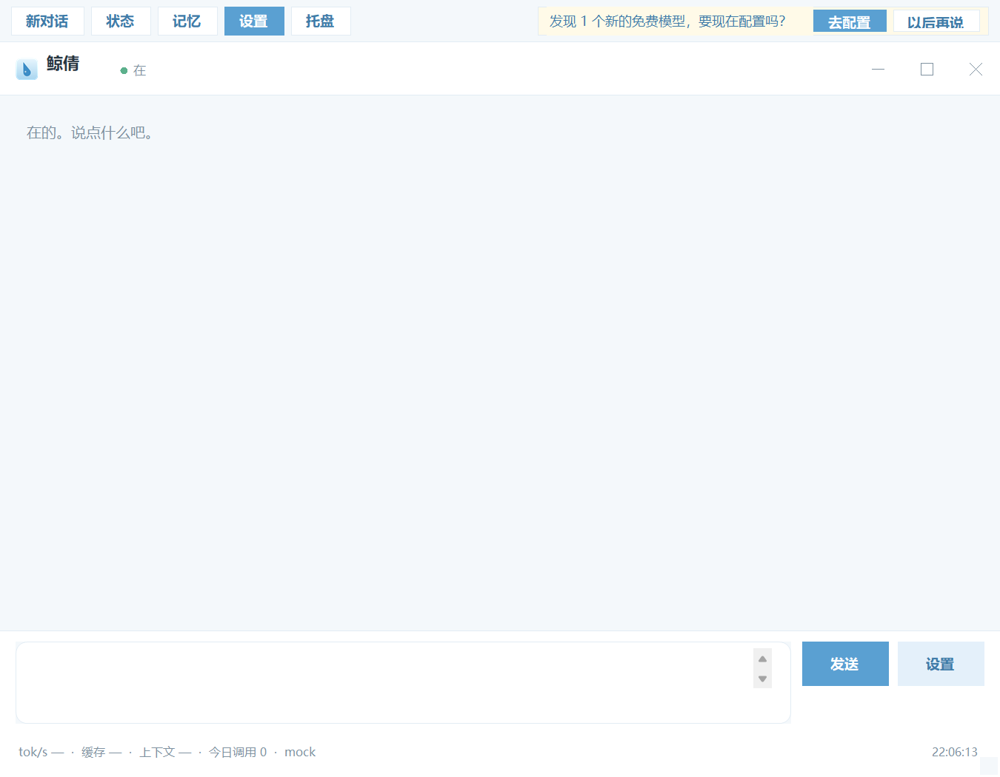

# 免费模型雷达

「免费模型雷达」是在动态额度之上加的一层**提醒**：定期看看公开页面，有没有冒出新的免费模型或新的免费额度，有就问你一句要不要配置。

它只做提醒。**绝不自动写密钥、绝不自动启用模型**——密钥这件事，永远只能你自己填。

代码在 `src/radar.js`，接口是 `GET /api/radar` 和 `POST /api/radar/ack`，用例在 `evals/radar-test.js`。

## 它怎么跑

- 服务启动后 **60 秒**跑第一次，之后**每 7 天**一次（`config.radar.delayMs` / `intervalMs` 可改）；
- `config.radar.enabled = false` 直接关掉；
- `config.radar.sources` 没配（空数组）就等于不跑；`config.example.json` 默认放了一条 OpenRouter 的公开模型接口，不想要就清空。`radar.delayMs` / `intervalMs` 可改（默认 60 秒后第一次、之后每 7 天）。

每次扫描：

1. 抓 `sources` 里每个公开页面的文本（只发一个普通 GET，带 `user-agent: jingqian-radar/1.0`，**不带 cookie、不带账号头**）；
2. 宽松地找「模型名 + 免费 / 永久免费 / 每天 X 万 tokens」这种组合，产出 `{ provider, model, quota, sourceUrl, foundAt }`；
3. 和 `data/model-radar.json` 里的已知清单比，按 `provider + 模型名 + 来源` 去重，**只把新增的挑出来**；
4. 新增的写进 `data/radar-pending.json`，等页面来读。

## 在哪儿提醒

不复用系统通知，也不弹窗——他可能正在用电脑。只在页面里顶部加一条可关的横条：

- 网页版：`public/index.html` 打开时读 `GET /api/radar`，有 `new` 就显示
  「发现 N 个新的免费模型（glm-4-flash 等），要现在配置吗？」；
- 软件版：`desktop/Shell.cs` 启动、服务连上后问一次，有就在顶部工具栏右侧显示一条（「发现 N 个新的免费模型，要现在配置吗？」）；具体是哪几个、来源是哪页，去设置页或网页版看。

软件版实测（`JQ_RADAR_DEMO=1` 让截图时先问一次雷达）：



两个按钮：

- **去配置**：跳到设置页（网页版 `/console.html`，软件版打开设置窗体）。网页版会把模型名和来源填进「加一家」的表单，**密钥留空、enabled 关着**；软件版只打开设置页，横条里已经写了模型名；
- **以后再说**：调 `POST /api/radar/ack`，把这些条目标记为已读，之后不再提醒（条目本身留在 `model-radar.json` 里当历史，不会丢）。

## 配置

```json
"radar": {
  "enabled": true,
  "sources": [
    { "name": "OpenRouter", "type": "openrouter", "url": "https://openrouter.ai/api/v1/models" },
    { "name": "智谱", "url": "https://open.bigmodel.cn/pricing" },
    "https://example.com/free-models"
  ],
  "delayMs": 60000,
  "intervalMs": 604800000
}
```

`name` 只是显示用的来源名，不填就用域名。`sources` 留空 = 不跑。

来源有两种解析方式：

- 普通网页（默认）：抓 HTML 文本，找「免费/free/赠送/试用/限免」附近出现的模型名和额度；
- `"type": "openrouter"` 或 `"type": "json"`：读公开的模型列表接口（比如 OpenRouter 的 `/api/v1/models`，不用登录），`pricing.prompt` 和 `pricing.completion` 都是 `0` 的算免费。这条源比抓宣传页稳：结构固定，不靠「免费」两个字。

`config.example.json` 里默认放了一条 OpenRouter 的公开接口（也就是默认每 7 天会去拉一次这个公开列表）。不想要就把 `sources` 清空，或者 `"enabled": false`。

## 会抓什么，不会抓什么

**会抓**：

- 公开定价页/模型列表页里写在正文里的「免费」「永久免费」「每天 X 万 tokens」；
- 同一页里同时出现模型名和免费描述的条目（模型名写在上一行或下一行也认）；
- 公开模型接口（`type: openrouter` / `json`）里单价为 0 的模型。

**不会抓**：

- 需要登录、需要 cookie、有鉴权的页面——一个都不碰；
- 前端 JS 动态渲染出来的内容（我们只读返回的 HTML 文本，不执行脚本）；
- 图片里、PDF 里、折叠展开之后才出现的内容；
- 活动细则、限时免费的具体规则（只会抓到「免费」这个信号和旁边的数字）；
- 你账号下的实际额度（那是账号后台的事，见 `docs/额度策略.md`）。

页面改版、下架、404 的时候：**保留旧清单，写一条 warn 到 `data/radar.log`，不报错、不崩、不清空**。所以雷达可能「慢了」，但不会把你知道的东西弄丢。

## 为什么只提示，不自动加密钥、不自动启用

- 抓到「某个模型免费」不等于「你有一条能用的 key」。密钥得你自己去注册、自己粘；
- 自动把抓来的模型塞进 `providers` 并启用，等于让一个抓网页的脚本替你决定「用谁家的模型、把请求发到哪里」。抓错了、页面写错了，你的聊天内容就发给了一个陌生端点；
- 开源版的原则是：**凡是花你钱、动你账号、决定请求去向的事，都要你点头**。雷达只负责把「有新的免费东西」这条信息摆在你面前。

所以它的边界很简单：能提醒，能记住你「以后再说」，能保留历史清单；不能替你配置，不能替你启用，不能替你花钱。

## 日志与状态

| 文件 | 内容 |
| --- | --- |
| `data/model-radar.json` | 已知清单（含 `acked` 标记），去重的依据 |
| `data/radar-pending.json` | 还没被处理的条目，端上读这个 |
| `data/radar.log` | 每次 scan / warn / ack 一行 JSONL |

## 测试

`node evals/radar-test.js`（已进 CI，本地起一个假 HTML 页面 + 一个假 JSON 接口，不联网）：19 条断言，覆盖解析（只认免费的、额度数字对）、新条目识别与落盘、重复扫描不重复提醒、页面 404 时保留旧清单不崩、ack 之后待处理清零但清单不丢、JSON 源只认单价为 0 的。
