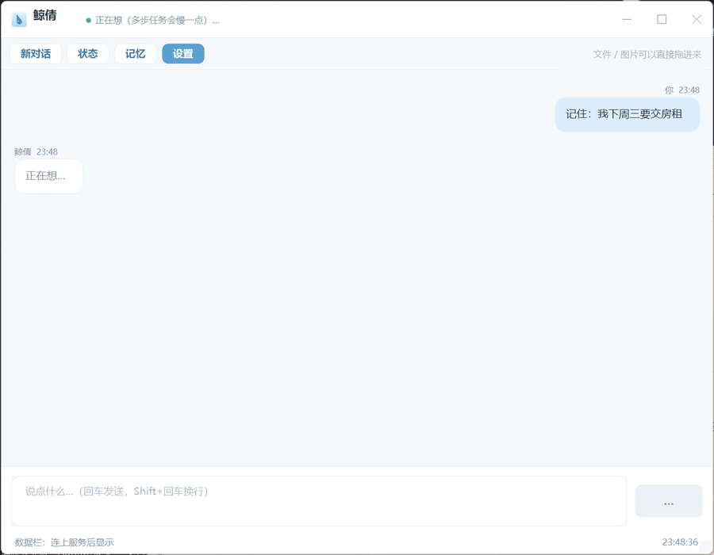
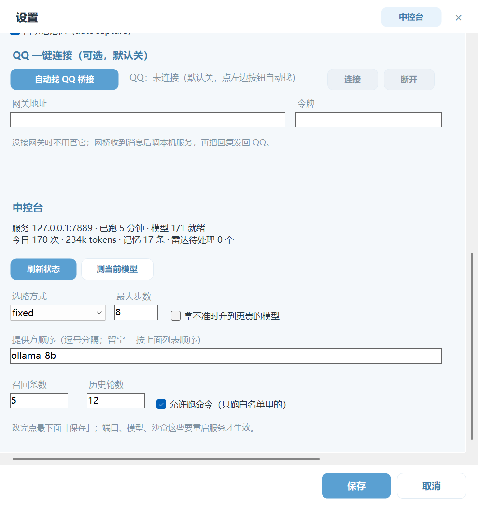
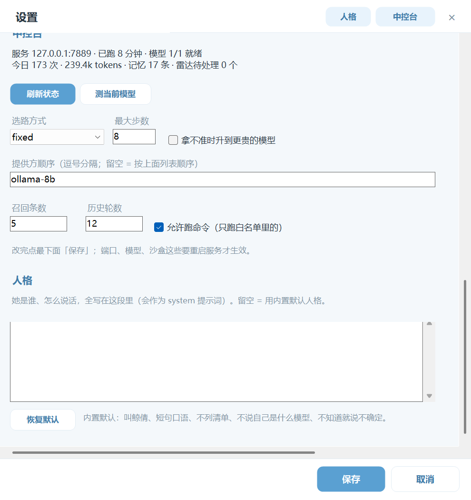
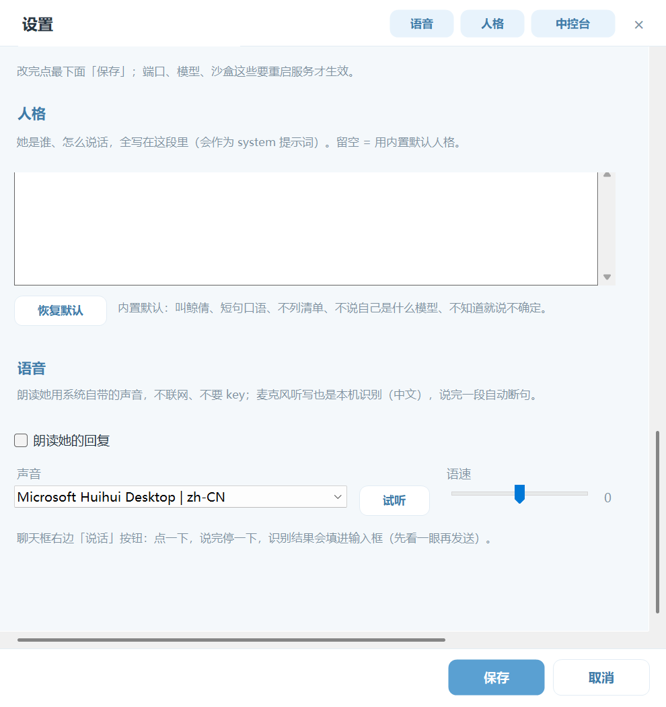

# 软件版（C# 窗口）：怎么装、怎么用、跟网页版什么关系

## 一、一个核、几个前端

- **软件窗口**：`desktop\鲸倩.exe`，双击开一个独立窗口，不跳浏览器。这是给普通用户的主入口。
- **DSH / 其他客户端**：2.0 计划（内置 MCP 适配已有开发通道，但这一版不做设置向导）。见 `docs/2.0-DSH接入.md`。
- **QQ 桥接**：可选，默认关，见 `docs/接QQ.md`。
- **网页版**：`node src/server.js` 后开 `http://127.0.0.1:7889`，**开发调试用**，不是给用户的功能形态。
- 都共用**同一个 Node 服务**：聊天、记忆、工具、红线、账本全在服务里，窗口只是个壳。
  关掉窗口服务还在跑；反过来服务没起，窗口会自己拉。

### 对话 / 工作模式

- **对话**：不挂工具，只聊天，免费模型也能用；认出是干活的话，会问一句要不要切工作模式。
- **工作**：挂全套工具，只让能动手的模型接活；固定到带不了工具的家会直接说清楚，不偷偷换。
- 每个入口各一份：`config.json` 的 `modes`（默认窗口=对话、QQ/MCP=工作），窗口工具栏开关只管窗口。
- 热切换，不用重启。细节见 `docs/2.0-一核两前端.md`（模式那节对 1.x 同样适用）。

- **软件窗口跑的是「单A」模板。** 仓库里的 2A / 3A（多角色、互相质检）是另外两套对照实现，
  只能命令行跑（`src-2a/`、`src-multi/`），设置里没有切换开关——别在设置里找，找不到是正常的。

## 二、怎么编

```cmd
cd desktop
build-desktop.cmd
```

用系统自带 `C:\Windows\Microsoft.NET\Framework64\v4.0.30319\csc.exe` 编单文件 WinForms，
不引 NuGet、不用 WebView2。产物：`desktop\鲸倩.exe`（约 72 KB）+ 同目录 `icon.ico` / `icon.png`。
失败时 csc 会把行号和原因打出来。

## 三、怎么装

```powershell
powershell -ExecutionPolicy Bypass -File 安装.ps1
```

会做三件事：

1. 把整个程序拷到 `%LOCALAPPDATA%\Jingqian\app`（没装 Node 会顺带下便携版到 `runtime\`）；
2. 桌面 + 开始菜单建「鲸倩」快捷方式，指向 `desktop\鲸倩.exe`，图标用 `desktop\icon.ico`；
3. 保留网页版兜底入口（开始菜单「网页版（调试用）」），不写进主流程。

第一次用（给纯小白的路径）：打开软件 → 如果一家模型都没接上，会弹「先填一家模型」→ 点「是」进设置 →

1. 列表里内置了四家：智谱 GLM-4-Flash（有免费额度，推荐先用）、DeepSeek、硅基流动、本机 Ollama；
   每家后面标着「已填 / 未填」。
2. 选中一家「未填」的，点顶部「申请密钥」，会直接打开官网的 key 页面（注册 → API Keys → 复制）。
3. 把 key 粘到下面「密钥」那一栏 → 点下面「保存」→ 关掉窗口重开，就能聊了。

不想注册也行：本机装 Ollama 后 `ollama pull qwen3:8b`，选 `ollama-8b` 这家直接用（不用 key）。

## 四、界面能干什么

- 顶部：标题栏（拖窗口 / 最小化 / 最大化 / 关闭）在最上面，下面一排功能按钮：新对话 / 状态 / 记忆 / 设置；
  关窗口是最小化进托盘，双击图标回来，托盘菜单可退出（不再单独放「托盘」按钮）。
- 中间消息区：用户右侧、鲸倩左侧；名字和时间在气泡上方，**调用了什么工具、结果是什么，显示成居中的灰色小条**；
  多步任务时先显示「正在想…」，不会卡死。没有对话时是居中的欢迎页，不是左上角一行灰字。
- 底部：输入框（回车发送，Shift+回车换行；空的时候有提示字，内容超过三行才出滚动条）+ 发送；
  往下一条**数据栏**：`tok/s · 缓存命中 · 上下文 · 今日调用 · 走哪家 · 时钟`，鼠标悬停看今天用量。
  服务没给的字段显示「—」，不编。
- **拖文件 / 图片进窗口**：拖到窗口任意位置，会贴到输入框上方变成小标签，点标签上的 × 撤掉；一次最多 6 个。
  发送时由服务端读文件（不联网）：
  - 文本类（.txt/.md/.js/.json/.csv/.log/...）把内容接进这一轮对话，单个最多 200 KB，超了会明说「只看了前 N KB」；
  - 图片（.png/.jpg/.gif/.webp/.bmp）走多模态；当前模型不支持看图时会直说「看不了图片」，
    让你换一家在 `config.json` 的 provider 上标了 `"vision": true` 的，或者把图里的字打给她；
  - 其它格式只记名字和大小，不读内容。
- 记忆面板：搜索（空的时候有提示字，不再是空白框）、看列表（类型中文化：事实/偏好/关系/约定…）、
  双击看全文、删除一条（远端走 `/api/memory` 和 `/api/memory/archive`）。
- **语音**（设置页头部「语音」按钮；都不联网、不要 key）：
  - 朗读：勾上「朗读她的回复」，回复念出来；声音下拉里挑系统声音（有中文就用中文），
    语速 -10~10，点「试听」听一句；工具栏「朗读」按钮可以一键开关（本次运行有效）。
  - 听写：聊天框右边「说话」→ 说一段、停一下 → 认出来的字填进输入框，先看一眼再发，不会替你直接发。
    第一次可能会弹麦克风权限；系统里得有中文语音识别（Windows 自带）。
- 设置页：和主窗口同一套浅蓝圆角；服务地址/端口、模型列表（**新增 / 删除 / 测试连接 / 申请密钥 / base/模型/密钥/档位，密钥可点「显示」**、
  每行标「已填/未填」）、沙盒档位（none/process/docker）、命令白名单、自动记记忆开关，以及可选的 QQ 桥接。
  保存前会检查端口和选中的提供方有没有填 base/模型；保存后写回 `config.json`，提示重启服务生效。
- **功能开关**（设置页头部「功能」按钮）：触手（看屏幕/点按打字/操作受控浏览器）、子智能体、
  开口说话（speak 工具）、看图（图片走视觉模型）、事件时间轴，逐项开关；关掉的工具不会出现在她的工具箱里。
  触手会动系统/浏览器的动作是 P1 红线，必须你回「确认」才真的动。检查更新也在这里（只查版本 + 打开下载页，不自动覆盖）。
- **中控台**（设置页头部按钮一点就跳过去）：看这台机器现在的状态——服务端口、已跑多久、模型几家就绪、
  今日调用次数与 token、记忆条数；带「刷新状态」「测当前模型」。
  下面能改选路（cheap-first / fixed / cloud-first、最大步数、拿不准时升档、提供方顺序）、
  记忆召回条数与历史轮数、是否允许跑命令。这些保存后同样写回 `config.json`，重启服务生效。
- **人格**（设置页头部「人格」按钮）：一段自由文本，就是她的 system 提示词——她是谁、怎么说话、什么不能说。
  写在这里等于 `config.json` 的 `persona` 字段；**留空 = 用内置默认人格**（叫鲸倩、短句口语、不列清单、
  不解释自己是 AI、不知道就说不确定）。点「恢复默认」清空后保存即可回去。保存后重启服务生效。
- 界面尺寸按 DPI 缩放（125% / 150% 不切字）；设置页内容多时可以上下滚。



<sub>真窗口录的 GIF：记一件事 → 问回来 → 让它排个先后。</sub>








## 五、接 QQ（可选，默认关闭）

1. **默认不支持、默认关闭。** 装完不能直接连 QQ，这是故意的——要账号、有风控，不该是默认形态。
2. **想接怎么做**：
   1) 自己起一个 OneBot 类网关（SnowLuma 那种），拿到它的 HTTP/WS 地址和令牌；
   2) 打开软件「设置」→ 勾选「启用 QQ 桥接」，填「网关地址」和「令牌」，保存；
   3) 网桥收到 QQ 消息后调本机服务 `POST /api/chat`（和软件版同一个服务），再把回复发回 QQ。
   配置字段（写在 `config.json`）：

   ```json
   { "qqBridge": { "enabled": false, "url": "", "token": "" } }
   ```

   QQ 只是**第三个入口**（桌面 / 网页 / QQ），聊天、记忆、工具、红线全在本机。
   没配网关时软件不会报错刷屏，只在设置页显示「未配置」。
3. **风险与限制**：账号可能被风控；需要常驻进程；会掉线、要重连；别拿主号试；
   **不要把端口暴露到公网**（服务默认只听 127.0.0.1）。

## 六、出问题怎么退

- 窗口打不开 / 没反应：先在仓库根跑 `node src/server.js`，确认服务能起；或看 `desktop` 里 exe 是否被安全软件拦。
- 连不上服务：检查设置里的地址/端口；软件版启动时会探测，没起会自动用 `node src\server.js` 拉起来。
- 想彻底不用软件版：卸载 `%LOCALAPPDATA%\Jingqian` 目录、删桌面/开始菜单快捷方式即可；
  网页版仍然可用（`node src/server.js`）。
- 改了配置不生效：设置页保存后会提示，关掉窗口重开（重启服务）。

## 七、验收（这轮真跑过的）

`desktop\鲸倩.exe --verify` 会离屏跑四项、不弹窗：

- 窗口：离屏创建（-30000,-30000）+ PrintWindow 截图，标题栏/消息区/输入框/发送键全可见；
- 历史：拉 `/api/history?session=web`（兼容旧的 desktop），有历史就铺成气泡，铺了多少条会打出来；
- 工具：真发一条「建 out.txt 写 hello 软件版」，窗口里出现「工具 write_file · 结果：写了 out.txt（15 字节）」；
- 服务：先关掉服务再跑，它自己拉起并连通；
- 设置：按设置窗同一条保存路径改 `config.json` 的 model，改前/改后/还原三次都核对。

截图：`desktop/_verify-window.png`、`desktop/_verify-tools.png`。

## 八、命令行参数（录演示 / 自测用）

```cmd
:: 正常开窗
desktop\鲸倩.exe

:: 打开后自动用同一套发送逻辑发一条（不用模拟键盘），窗口里能看到过程和回复
desktop\鲸倩.exe --send "帮我记一下：我周三晚上打羽毛球"

:: 演示/截图：发一条、等这一轮（含工具小条）上屏、抓一张图再关窗
desktop\鲸倩.exe --send-shot data\demo.png --send "让模型用插件工具做点什么"

:: 离屏自检（不弹窗，跑完打印 PASS/FAIL）
desktop\鲸倩.exe --verify

:: 只拉服务 / 指定服务地址
desktop\鲸倩.exe --ensure-service
desktop\鲸倩.exe --url http://127.0.0.1:7889
```

- 软件版聊天用 `session=web`，和网页版共用同一份会话历史；打开时会先拉历史再决定要不要显示欢迎语。
- 窗口显示后输入框自动获得焦点；发完一条、关掉设置窗也会把焦点还回输入框。
- `JQ_SHELL_OFFSCREEN=1` 环境变量可让窗口建在屏幕外（CI/自测用）。

### 历史气泡自证

```cmd
:: 启动后打印 bubbles=N（走正常启动的同一套 LoadHistoryWithRetry）
desktop\鲸倩.exe --dump-bubbles

:: 顺便截一张图（窗口在屏幕外，抓完立刻关）
desktop\鲸倩.exe --dump-bubbles --shot desktop\_verify-history.png

:: 一条命令的回归检查（bubbles>0 + 截图非空白 + 退出码 0）
node evals\desktop-history-test.js
```

历史加载顺序：先等服务就绪 → 再拉 `/api/history?session=web`（兼容 `desktop` 和 `text` 字段）
→ 最多重试 3 次、每次间隔 1 秒 → 有历史就铺气泡、隐藏欢迎语、滚动条拉到底。
（之前消息区空白的真正原因：滚动后 `AutoScrollPosition` 是负数，绘制时用减号把内容画到了视口外。）

## 九、换模型和看花费（1.5.0）

**换模型**：窗口右上角那个下拉，点一下就行。

- 三个自动档：`自动：先免费 / 本地`（默认，便宜的先上）、`自动：先云端`（要质量就选这个）；
- 指定某一家：直接选名字，等于固定走它；它挂了仍会自动退到后面的家，不会卡死；
- 没填 key 的家会显示「未配置」，选了也不会生效；
- **改完立刻生效，不用重启服务**，下一轮就走新的。

网页版头部同一位置也有这个下拉，两边改的是同一份 `config.json`。

**看花费**：工具栏右边的「今日 ¥x.xxx」，点开是账单窗。

- 今日按家明细（每次数、金额）+ 今日合计 + 近 7 天合计；
- 「重置今日」只记一条水位线，**原始按天账本不删**，想反悔把 `data/cost-reset.json` 删掉就恢复全天累计；
- 金额按 provider 的 `price_in/price_out` 估算，本地和免费模型记 0；
- 已知局限：多台机器共用一个 key 时，账本只算本机，会偏乐观。

接口：`GET /api/route`、`POST /api/route {mode|pin|order}`、`GET /api/cost?days=7`、`POST /api/cost/reset`
（切换和重置只给本机调用）。截图：`docs/assets/软件版-模型切换.png`、`docs/assets/软件版-账单.png`。

## 十、选中和复制（1.7.0）

气泡是自绘的，系统拿不到里面的文字，所以复制走的是自己这条：

- 左键点一下气泡 → 选中（描一圈）；`Ctrl+C` 复制这一条；
- 没选中任何气泡时 `Ctrl+C` 或 `Ctrl+A` → 复制整段对话；
- 右键气泡 → 「复制这条 / 复制全部对话」；
- `Esc` 取消选中；
- 复制出来的文字带说话人（你 / 鲸倩），附件和工具小条也会带。

自检：`desktop\鲸倩.exe --verify` 里的 `COPY OK chars=N` 会真选中、真读剪贴板核对。
想整段文字像网页那样拖选，得把气泡换成可选中控件或嵌网页内核，这一版没做。

## 十一、接上密钥先选模型（1.8.0）

密钥不绑模型：它认的是「哪一家」，那家支持什么模型你就能用哪个。

- 设置页「模型」旁边有「选模型…」：点开会用这一家的地址 + 这把 key 去问 `/v1/models`，
  列出**这把 key 现在能用的模型**，选中就填进去；列表里也能自己手填模型名。
- 填完 key 点「测试连接」，通了而模型名还空着，会自动弹出这个选模型窗，
  不用你去背模型名。
- 问不到列表（有些家不开放 `/v1/models`）时，会说清楚原因，只给几个常见模型当建议，不会假装拿到了列表。
- 想换模型随时再点「选模型…」，或者直接改那个输入框；保存后重启服务生效。
- 接口：`POST /api/models {name}` 或 `{base, key}` → `{ok, models, source: 'list'|'preset', error}`（只给本机）。

## 十二、选路的规矩（1.9.0）

工具栏那个下拉现在是三句话：`自动（该省省、该花花）`、`质量优先（先云端）`、或者直接指定某一家。

- **自动**：先本机/免费的，遇到长任务、分析类的话往上提一档走云端；
- **固定某一家**：你说走哪家就走哪家，不会被"难活升级"改掉；它挂了才会往后退；
- **会话里尽量不换人**：上一轮谁答的，这一轮还是先找它；
- **刚失败的家冷落 60 秒**：排到最后，但没删——只剩它时照样会用；
- **本地空着回来**（没说话也没调工具）：自动换云端补一次，不把空白甩给你；
- **全挂**：分三种说法——key 不对 / 额度用完 / 连不上，各给下一步，不甩 HTTP 400。

难度看三样：这句话有多长、上下文有多长、有没有「分析/设计/代码」这类词。
想在配置里标某家不支持工具调用：`"tools": false`，要用工具的那一轮就不会选它。

## 十三、上手教程（1.9.0）

工具栏「上手」是四步图文：接一家模型、直接聊、换模型看花费、进阶（拖文件/记忆/插件/语音）。
第一次打开会自动弹一次，看过了就不再弹（想再看随时点按钮）。

## 十四、人称怎么处理的（1.10.0）

分成「存」和「用」两层：

- **存**：记忆库一律第三人称（「用户喜欢喝美式」「用户的猫叫团子」），这样去重、检索、跨会话都稳；
- **用**：喂给模型之前换成第二人称（「你喜欢喝美式」），参考记忆块前面还会写一句
  「这里的『你』都是他，别对他说『用户』」；
- 人格里有硬规矩：他是「你」，从不用「用户」称呼他，也不把他说的事说成自己的经历；
- 换人称只改展示层，库里的原文不动（`evals/persona-test.js` 就是验这个）。

要是还看见称呼串了，把那句话原样发我，我照着它调。

## 十五、新手顺手的三件事（1.10.0）

- 空对话第一屏有三个能点的例子，不用自己想说什么；
- 等得久会说一句「还在想…」/「等不及可以换一家」，不让人以为卡死；
- 窗口大小和位置会记住，下次打开还是你摆的样子。

