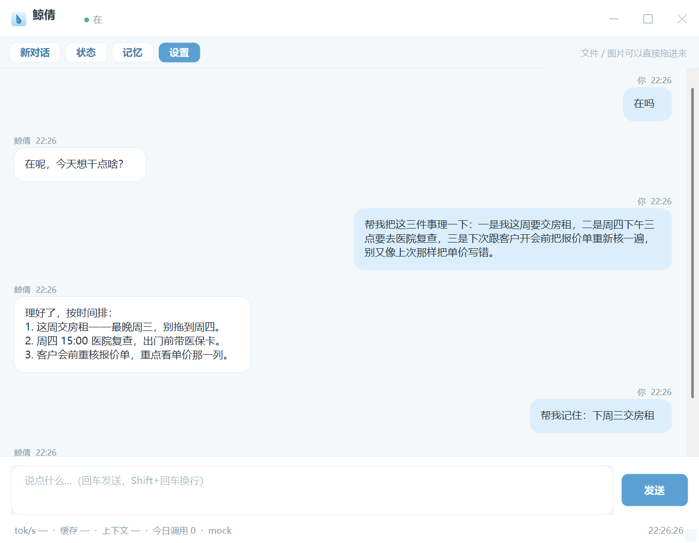
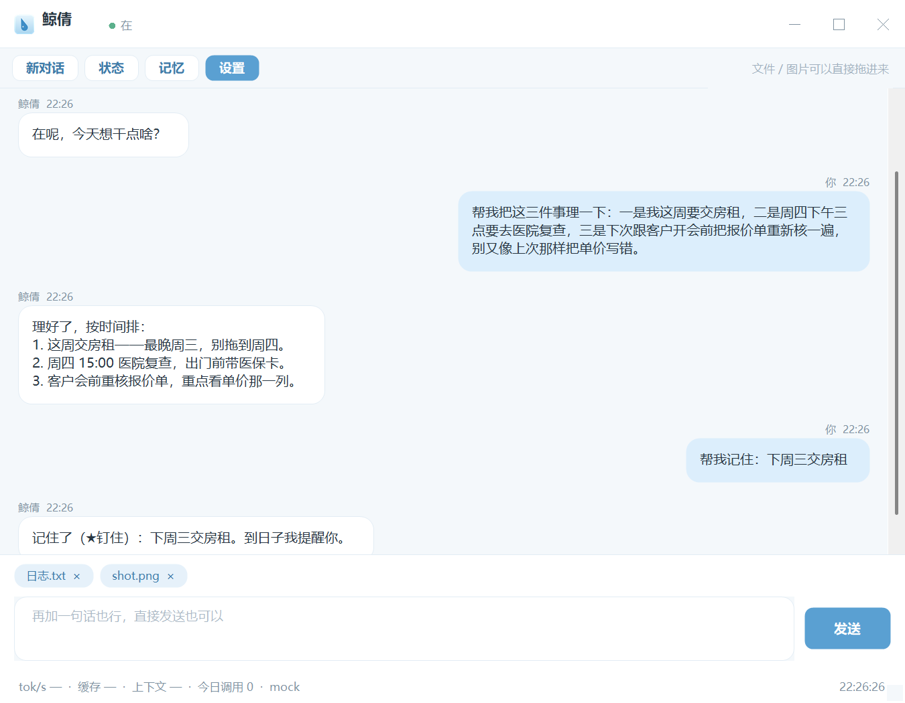
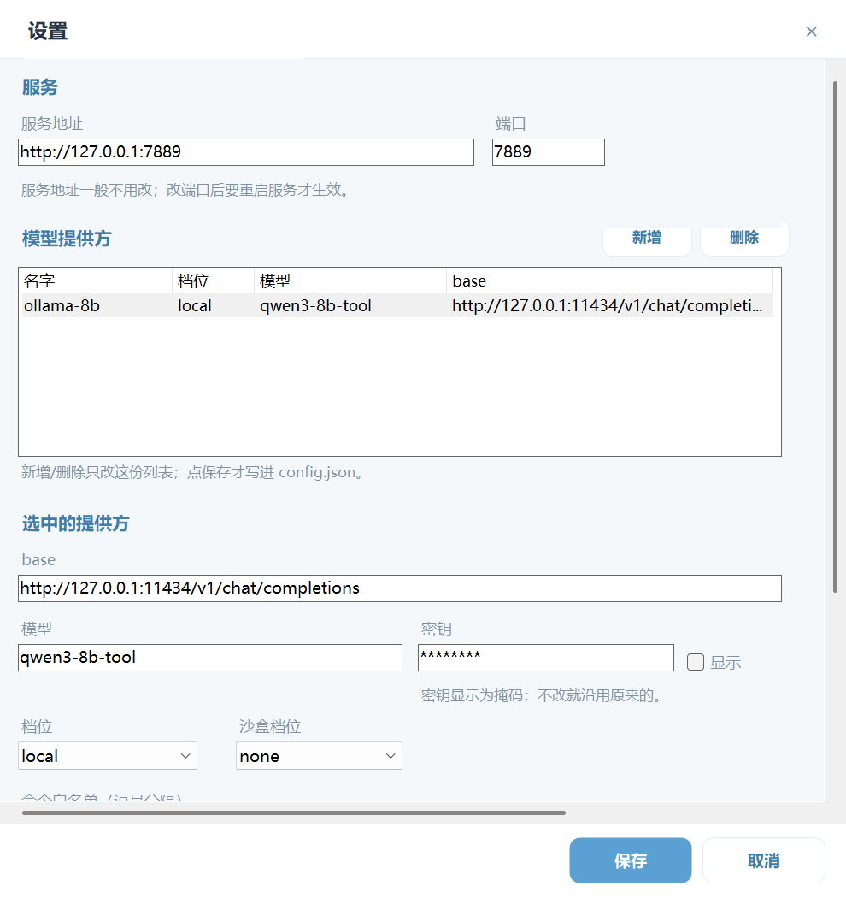
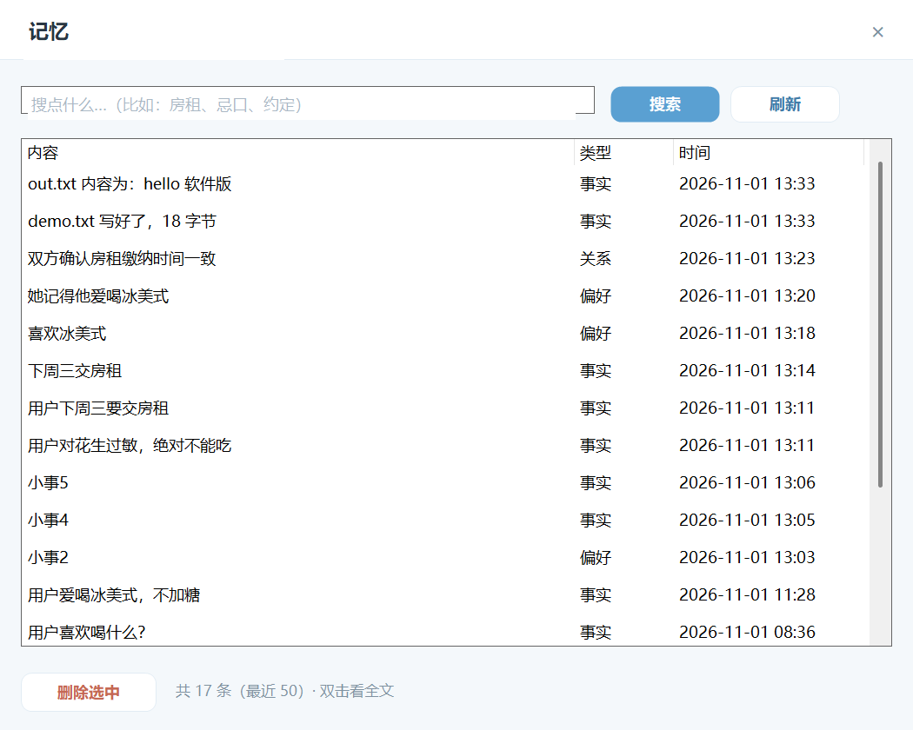

# 软件版（C# 窗口）：怎么装、怎么用、跟网页版什么关系

## 一、两个形态，一个服务

- **软件版**：`desktop\鲸倩.exe`，双击开一个独立窗口，不跳浏览器。这就是给普通用户用的形态。
- **网页版**：`node src/server.js` 后开 `http://127.0.0.1:7889`，**开发调试用**，不是给用户的功能形态。
- 两者共用**同一个 Node 服务**：聊天、记忆、工具、红线、账本全在服务里，软件版只是个壳。
  关掉窗口服务还在跑；反过来服务没起，软件版会自己拉。

## 二、怎么编

```cmd
cd desktop
build-desktop.cmd
```

用系统自带 `C:\Windows\Microsoft.NET\Framework64\v4.0.30319\csc.exe` 编单文件 WinForms，
不引 NuGet、不用 WebView2。产物：`desktop\鲸倩.exe`（约 72 KB）+ 同目录 `icon.ico` / `icon.png`。
失败时 csc 会把行号和原因打出来。

## 三、怎么装

```powershell
powershell -ExecutionPolicy Bypass -File 安装.ps1
```

会做三件事：

1. 把整个程序拷到 `%LOCALAPPDATA%\Jingqian\app`（没装 Node 会顺带下便携版到 `runtime\`）；
2. 桌面 + 开始菜单建「鲸倩」快捷方式，指向 `desktop\鲸倩.exe`，图标用 `desktop\icon.ico`；
3. 保留网页版兜底入口（开始菜单「网页版（调试用）」），不写进主流程。

第一次用：打开软件 → 点顶部的「设置」，填一家模型密钥；或者本机 `ollama pull qwen3:8b` 用本地模型。

## 四、界面能干什么

- 顶部：标题栏（拖窗口 / 最小化 / 最大化 / 关闭）在最上面，下面一排功能按钮：新对话 / 状态 / 记忆 / 设置；
  关窗口是最小化进托盘，双击图标回来，托盘菜单可退出（不再单独放「托盘」按钮）。
- 中间消息区：用户右侧、鲸倩左侧；名字和时间在气泡上方，**调用了什么工具、结果是什么，显示成居中的灰色小条**；
  多步任务时先显示「正在想…」，不会卡死。没有对话时是居中的欢迎页，不是左上角一行灰字。
- 底部：输入框（回车发送，Shift+回车换行；空的时候有提示字，内容超过三行才出滚动条）+ 发送；
  往下一条**数据栏**：`tok/s · 缓存命中 · 上下文 · 今日调用 · 走哪家 · 时钟`，鼠标悬停看今天用量。
  服务没给的字段显示「—」，不编。
- **拖文件 / 图片进窗口**：拖到窗口任意位置，会贴到输入框上方变成小标签，点标签上的 × 撤掉；一次最多 6 个。
  发送时由服务端读文件（不联网）：
  - 文本类（.txt/.md/.js/.json/.csv/.log/...）把内容接进这一轮对话，单个最多 200 KB，超了会明说「只看了前 N KB」；
  - 图片（.png/.jpg/.gif/.webp/.bmp）走多模态；当前模型不支持看图时会直说「看不了图片」，
    让你换一家在 `config.json` 的 provider 上标了 `"vision": true` 的，或者把图里的字打给她；
  - 其它格式只记名字和大小，不读内容。
- 记忆面板：搜索（空的时候有提示字，不再是空白框）、看列表（类型中文化：事实/偏好/关系/约定…）、
  双击看全文、删除一条（远端走 `/api/memory` 和 `/api/memory/archive`）。
- 设置页：和主窗口同一套浅蓝圆角；服务地址/端口、模型列表（**新增 / 删除 / base/模型/密钥/档位，密钥可点「显示」**）、
  沙盒档位（none/process/docker）、命令白名单、自动记记忆开关，以及可选的 QQ 桥接。
  保存后写回 `config.json`，提示重启服务生效。
- 界面尺寸按 DPI 缩放（125% / 150% 不切字）；设置页内容多时可以上下滚。
- 雷达提示条：发现新的免费模型时，工具栏下面出一条浅黄横条（去配置 / 以后再说），详见 `docs/免费模型雷达.md`。









## 五、接 QQ（可选，默认关闭）

1. **默认不支持、默认关闭。** 装完不能直接连 QQ，这是故意的——要账号、有风控，不该是默认形态。
2. **想接怎么做**：
   1) 自己起一个 OneBot 类网关（SnowLuma 那种），拿到它的 HTTP/WS 地址和令牌；
   2) 打开软件「设置」→ 勾选「启用 QQ 桥接」，填「网关地址」和「令牌」，保存；
   3) 网桥收到 QQ 消息后调本机服务 `POST /api/chat`（和软件版同一个服务），再把回复发回 QQ。
   配置字段（写在 `config.json`）：

   ```json
   { "qqBridge": { "enabled": false, "url": "", "token": "" } }
   ```

   QQ 只是**第三个入口**（桌面 / 网页 / QQ），聊天、记忆、工具、红线全在本机。
   没配网关时软件不会报错刷屏，只在设置页显示「未配置」。
3. **风险与限制**：账号可能被风控；需要常驻进程；会掉线、要重连；别拿主号试；
   **不要把端口暴露到公网**（服务默认只听 127.0.0.1）。

## 六、出问题怎么退

- 窗口打不开 / 没反应：先在仓库根跑 `node src/server.js`，确认服务能起；或看 `desktop` 里 exe 是否被安全软件拦。
- 连不上服务：检查设置里的地址/端口；软件版启动时会探测，没起会自动用 `node src\server.js` 拉起来。
- 想彻底不用软件版：卸载 `%LOCALAPPDATA%\Jingqian` 目录、删桌面/开始菜单快捷方式即可；
  网页版仍然可用（`node src/server.js`）。
- 改了配置不生效：设置页保存后会提示，关掉窗口重开（重启服务）。

## 七、验收（这轮真跑过的）

`desktop\鲸倩.exe --verify` 会离屏跑四项、不弹窗：

- 窗口：离屏创建（-30000,-30000）+ PrintWindow 截图，标题栏/消息区/输入框/发送键全可见；
- 历史：拉 `/api/history?session=web`（兼容旧的 desktop），有历史就铺成气泡，铺了多少条会打出来；
- 工具：真发一条「建 out.txt 写 hello 软件版」，窗口里出现「工具 write_file · 结果：写了 out.txt（15 字节）」；
- 服务：先关掉服务再跑，它自己拉起并连通；
- 设置：按设置窗同一条保存路径改 `config.json` 的 model，改前/改后/还原三次都核对。

截图：`desktop/_verify-window.png`、`desktop/_verify-tools.png`。

## 八、命令行参数（录演示 / 自测用）

```cmd
:: 正常开窗
desktop\鲸倩.exe

:: 打开后自动用同一套发送逻辑发一条（不用模拟键盘），窗口里能看到过程和回复
desktop\鲸倩.exe --send "帮我记一下：我周三晚上打羽毛球"

:: 离屏自检（不弹窗，跑完打印 PASS/FAIL）
desktop\鲸倩.exe --verify

:: 只拉服务 / 指定服务地址
desktop\鲸倩.exe --ensure-service
desktop\鲸倩.exe --url http://127.0.0.1:7889
```

- 软件版聊天用 `session=web`，和网页版共用同一份会话历史；打开时会先拉历史再决定要不要显示欢迎语。
- 窗口显示后输入框自动获得焦点；发完一条、关掉设置窗也会把焦点还回输入框。
- `JQ_SHELL_OFFSCREEN=1` 环境变量可让窗口建在屏幕外（CI/自测用）。

### 历史气泡自证

```cmd
:: 启动后打印 bubbles=N（走正常启动的同一套 LoadHistoryWithRetry）
desktop\鲸倩.exe --dump-bubbles

:: 顺便截一张图（窗口在屏幕外，抓完立刻关）
desktop\鲸倩.exe --dump-bubbles --shot desktop\_verify-history.png

:: 一条命令的回归检查（bubbles>0 + 截图非空白 + 退出码 0）
node evals\desktop-history-test.js
```

历史加载顺序：先等服务就绪 → 再拉 `/api/history?session=web`（兼容 `desktop` 和 `text` 字段）
→ 最多重试 3 次、每次间隔 1 秒 → 有历史就铺气泡、隐藏欢迎语、滚动条拉到底。
（之前消息区空白的真正原因：滚动后 `AutoScrollPosition` 是负数，绘制时用减号把内容画到了视口外。）
